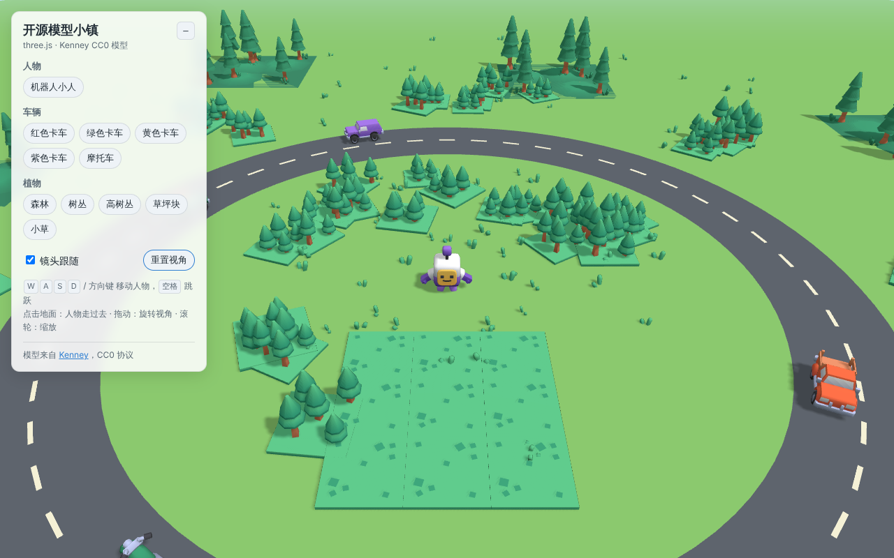

# three_figure · 开源模型小镇

用 three.js 搭建的演示场景，展示可以免费使用的开源 3D 模型：**人物、车辆、植物**。



## 运行

```bash
npm install
npm run dev
```

浏览器打开终端里显示的地址（默认 http://localhost:5173）。

打包静态文件：`npm run build`，产物在 `dist/`，可以直接放到 GitHub Pages 或任意静态服务器上。

## 部署到 GitHub Pages

仓库里已经带了工作流 `.github/workflows/deploy.yml`，推送到 `main` 后会自动构建并发布。第一次需要手动打开一次：

1. 仓库 **Settings → Pages → Build and deployment → Source** 选 **GitHub Actions**
   （私有仓库需要 GitHub Pro 等付费套餐，免费账户需先把仓库设为 Public）
2. 把代码合并到 `main`，或在 **Actions → Deploy to GitHub Pages → Run workflow** 手动运行
3. 部署完成后访问 `https://lyrisbeauty-cell.github.io/three_figure/`

## 玩法

- `W A S D` / 方向键：移动人物，`空格`：跳跃
- 点击地面：人物走过去；点击车辆或人物：镜头飞过去并跟随
- 左侧面板：按「人物 / 车辆 / 植物」列出所有模型，点一下就能定位
- 拖动旋转视角，滚轮缩放

## 模型来源

除 4 个真人比例的男女外，模型都来自 [Kenney](https://kenney.nl)，采用 **CC0** 协议（可商用，不要求署名），取自 Kenney 官方 GitHub 仓库：

| 类别 | 模型 | 来源 |
|---|---|---|
| 人物 | `character.glb`（带 idle / walk / jump 动画） | [Starter-Kit-3D-Platformer](https://github.com/KenneyNL/Starter-Kit-3D-Platformer) |
| 车辆 | 4 辆卡车 + 摩托车 | [Starter-Kit-Racing](https://github.com/KenneyNL/Starter-Kit-Racing) |
| 植物 | 树丛、高树丛、草坪块 | [Starter-Kit-City-Builder](https://github.com/KenneyNL/Starter-Kit-City-Builder) |
| 植物 | 森林 | Starter-Kit-Racing |
| 植物 | 小草 | Starter-Kit-3D-Platformer |
| 人物 | 男士 ×2、女士 ×2（办公室打扮） | [Quaternius Universal Base Characters](https://quaternius.com/packs/universalbasecharacters.html) |

详见 `public/models/LICENSE.txt`。

### 关于男女人物

Quaternius 的 Universal Base Characters 是「基础人体」：只穿内衣、没有头发、也不带动画。为了放进场景，`src/people.js` 做了三件事：

- **穿衣服**：着色器按身体部位上色（衬衫 / 西装 / 领带 / 裤子或裙子 / 鞋），颜色在 `src/main.js` 的 `peopleDefs` 里改
- **放下手臂**：把 T 字姿势的手臂转下来
- **走路动画**：用代码摆动大腿、小腿和手臂，人物会在公路内侧随机散步、停下休息

想要更真实的衣服和动作，可以下载 Quaternius 的服装包和 Universal Animation Library 替换。

### 想加更多模型？

这些地方也有大量 CC0 / 开源 glTF 模型，下载后放进 `public/models/`，在 `src/main.js` 的 `MODELS` 里加一行即可：

- [Kenney](https://kenney.nl/assets)：Car Kit、Nature Kit、Mini Characters 等
- [Quaternius](https://quaternius.com)：带动画的人物、Stylized Nature MegaKit
- [KayKit](https://kaylousberg.itch.io)：风格化角色与道具
- [Poly Pizza](https://poly.pizza)：上万个低多边形模型（注意区分 CC0 和 CC-BY）
- [Poly Haven](https://polyhaven.com/models)：写实扫描模型（面数较高）

注意：Kenney 的 glb 引用外部的 `Textures/colormap.png`，不同套件的调色板不同，需要和模型放在同一目录下。
